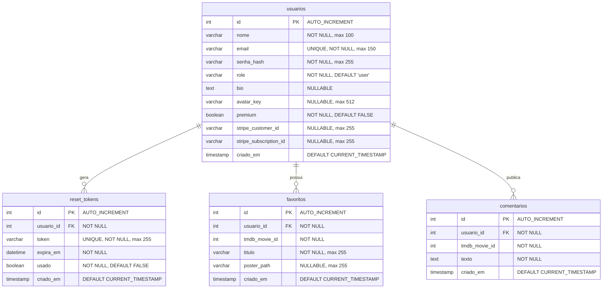

# 📘 Documentação Reversa do Sistema — Catálogo Tom Hanks

> **Disciplina:** Introdução à Computação em Nuvem (ISW055) — 2026.2  
> **Professor:** Prof. Allan Siriani ([@siriani](https://github.com/siriani))  
> **Aluno:** Iago Amorim Lebron de Lima  
> **Tenant / Matrícula:** `IAC_2026_02_iago_lima`  
> **Porta Reservada no Host:** `8210`  
> **Subdomínio de Borda:** `iago-lima.lapps.studio`  
> **Repositório:** [README Principal](README.md)

---

## Sumário Executivo

Este documento consolida a **especificação técnica e engenharia reversa** do ecossistema distribuído do **Catálogo de Filmes de Tom Hanks**, desenvolvido ao longo do semestre letivo de Computação em Nuvem. O sistema evoluiu de uma aplicação monolítica para uma arquitetura distribuída resiliente baseada em microsserviços conteinerizados, com segregação de responsabilidades em rede privada, consumo de serviços em nuvem (IaaS, PaaS e SaaS), controle de acesso baseado em papéis (RBAC), auditoria centralizada em tempo real, armazenamento de objetos (Object Storage S3) e integração com gateway de pagamentos para assinaturas recorrentes.

---

## 1. Especificação Funcional (Ponto de Vista do Usuário e Engenharia Reversa)

Esta seção descreve os módulos funcionais da aplicação a partir do fluxo de experiência do usuário e sua implementação técnica de baixo nível.

```
┌─────────────────────────────────────────────────────────────────────────────┐
│                             MÓDULOS FUNCIONAIS                              │
├─────────────────────┬───────────────────────┬───────────────────────────────┤
│ 1.1 Autenticação e  │ 1.2 Catálogo e        │ 1.3 Perfil de Usuário         │
│     Sessão (JWT)    │     Interações (TMDB) │     e Avatar (MinIO S3)       │
├─────────────────────┼───────────────────────┼───────────────────────────────┤
│ 1.4 Assinatura do   │ 1.5 Moderação RBAC    │ 1.6 Auditoria Centralizada    │
│     Plano Premium   │     (User vs Admin)   │     (Redis Streams)           │
└─────────────────────┴───────────────────────┴───────────────────────────────┘
```

### 1.1 Autenticação, Controle de Sessão e Recuperação de Senha

O ciclo de vida do usuário é gerenciado de ponta a ponta pelo microsserviço privado `auth-service` (FastAPI na porta interna 8001), desacoplado do gateway público `catalog-service`:

1. **Cadastro de Usuário (`POST /register` $\rightarrow$ `POST /auth/register`):**
   - Coleta `nome`, `email` e `senha`.
   - Exige tamanho mínimo de **6 caracteres** para a senha.
   - Valida a unicidade do e-mail no MariaDB; caso já exista, rejeita com `HTTP 400 Bad Request`.
   - Criptografa a senha utilizando o algoritmo **bcrypt** com salt aleatório (`passlib.context`).
   - Atribui por padrão o papel `role = 'user'`, permitindo provisionamento explícito de `role = 'admin'` quando configurado administrativamente.

2. **Login e Sessão (`POST /login` $\rightarrow$ `POST /auth/login`):**
   - Valida as credenciais contra o hash persistido no banco.
   - Se válidas, emite um **JSON Web Token (JWT)** assinado com a `SECRET_KEY` compartilhada via algoritmo `HS256`.
   - O payload do JWT embute as claims: `sub` (ID numérico do usuário), `nome`, `email`, `role` (`user` ou `admin`), `premium` (booleano) e `exp` (timestamp de expiração de 24 horas).
   - O `catalog-service` armazena o token no cliente via **Cookie HTTP-Only** (`access_token`, `SameSite=Lax`, `Max-Age=86400`), blindando o token contra ataques de *Cross-Site Scripting* (XSS).
   - Emite evento de auditoria `login` para o `log-service`.

3. **Validação de Sessão — Padrão A (Enforcement Centralizado):**
   - A cada requisição autenticada, o `catalog-service` extrai o cookie e submete ao endpoint interno `POST /auth/verify` do `auth-service`.
   - O `auth-service` decodifica a assinatura do token e consulta a tabela `usuarios` no MariaDB em tempo real.
   - **Vantagem Arquitetural:** O status do usuário (seus privilégios `role` e seu status `premium`) é avaliado diretamente na fonte da verdade. Se um usuário for promovido a admin ou tiver sua assinatura Premium cancelada, os novos privilégios têm efeito imediato, sem necessidade de aguardar a expiração do JWT.

4. **Recuperação de Senha com E-mail Transacional ("Esqueci Minha Senha"):**
   - **Solicitação (`POST /forgot-password`):** O usuário informa seu e-mail. Para evitar enumeração de contas, o sistema sempre retorna uma mensagem genérica de sucesso.
   - **Geração de Token Criptográfico:** Se o e-mail existir, o `auth-service` gera um token hexadecimal de alta entropia (`secrets.token_urlsafe(32)`), gravando-o na tabela `reset_tokens` com `expira_em = NOW() + 30 minutos` e flag `usado = FALSE`.
   - **Disparo SMTP (Mailtrap):** O serviço formata um e-mail HTML moderno contendo o link absoluto:  
     `https://<dominio>/reset-password?token=<hex_token>` e envia via conexão autenticada TLS com o servidor SMTP do Mailtrap.
   - **Validação de Token (`GET /reset-password?token=...`):** Antes de renderizar a tela de nova senha, o token é inspecionado rigorosamente: se não existir, se já estiver marcado como `usado == TRUE` ou se a data atual ultrapassar `expira_em`, a interface exibe erro de token expirado/inválido.
   - **Efetivação da Troca (`POST /reset-password`):** Recebe o token e a nova senha confirmada. Se válida (mínimo 6 chars), atualiza o `senha_hash` do usuário no MariaDB e marca o registro em `reset_tokens` com `usado = TRUE` (ineditismo estrito de uso).

5. **Logout (`GET /logout`):**
   - Registra o evento de auditoria `logout` com o ID do usuário.
   - Remove o cookie `access_token` do navegador via cabeçalho `Set-Cookie` com expiração retroativa e redireciona para a tela de login.

---

### 1.2 Catálogo de Filmes e Interações Sociais

O catálogo de filmes é a área central da aplicação, consumindo dados externos e persistindo as preferências dos usuários:

1. **Catálogo ao Vivo via TMDB API (`GET /catalog`):**
   - O `catalog-service` comunica-se assincronamente com a API pública do The Movie Database (TMDB), consultando o endpoint `/person/31/movie_credits` (ID 31 = Tom Hanks).
   - Os filmes são filtrados, normalizados e ordenados por popularidade e data de lançamento em tempo de execução.
   - **Eficiência de Armazenamento:** Os metadados e posters dos filmes **não** são duplicados no banco de dados local. Apenas títulos e referências necessárias para favoritos e comentários são persistidos, mantendo a base de dados enxuta.

2. **Favoritar e Desfavoritar Filmes (`POST /favorite/{id}` e `POST /favorite/{id}/remove`):**
   - **Favoritar:** Grava na tabela `favoritos` o par `(usuario_id, tmdb_movie_id)`. Se o filme já estiver favoritado, a restrição `UNIQUE (usuario_id, tmdb_movie_id)` impede duplicidade via comando SQL `INSERT IGNORE`.
   - **Regra do Plano Free vs Premium:** Usuários com plano gratuito são limitados a no máximo **3 filmes favoritos**. Ao atingir esse teto, novas inclusões são bloqueadas. Assinantes Premium possuem favoritos ilimitados.
   - **Desfavoritar:** Executa `DELETE FROM favoritos WHERE usuario_id = %s AND tmdb_movie_id = %s`. A inclusão obrigatória do `usuario_id` na cláusula `WHERE` mitiga qualquer possibilidade de ataque IDOR (*Insecure Direct Object Reference*).

3. **Comentários e Críticas (`POST /comment/{id}`):**
   - Usuários autenticados podem publicar críticas e opiniões na página de detalhes de cada filme (`GET /movie/{id}`).
   - O comentário é registrado na tabela `comentarios` contendo `usuario_id`, `tmdb_movie_id`, `texto` e `criado_em`.
   - A listagem exibe o nome do autor do comentário obtido via junção relacional (`JOIN usuarios u ON c.usuario_id = u.id`).

---

### 1.3 Perfil do Usuário e Gerenciamento de Avatar com MinIO S3

O sistema implementa uma página de perfil customizável com persistência desacoplada de dados textuais e binários:

1. **Exibição do Perfil (`GET /profile/{id}`):**
   - Consulta dados públicos do usuário (nome, bio, status premium e lista de filmes favoritos).
   - Renderiza a foto de avatar recuperada a partir do Object Storage.
   - Avalia se o usuário da requisição é o dono do perfil (`user["id"] == profile_user_id`); caso positivo, exibe o painel de edição de biografia e upload de imagem.

2. **Upload e Validação de Imagem (`POST /profile/{id}/upload`):**
   - **Controle de Autorização Rígido:** O endpoint compara o ID da rota com o ID extraído do token JWT autenticado. Tentativas de submissão para perfil de terceiros disparam **HTTP 403 Forbidden** e geram log de segurança `audit.security.access_denied`.
   - **Validação de Conteúdo (Content-Type):** O arquivo enviado é inspecionado no backend, aceitando exclusivamente imagens `image/jpeg`, `image/png`, `image/webp` e `image/gif`.
   - **Validação de Tamanho:** Rejeita arquivos com payload superior a **3 MB** (`MAX_UPLOAD_BYTES = 3 * 1024 * 1024`).
   - **Persistência no MinIO:** O binário é enviado para o bucket `avatars` utilizando o SDK oficial `minio-py`, gerando uma chave de objeto estruturada (`avatars/{user_id}-{uuid}.{ext}`).
   - **Limpeza de Órfãos:** Caso o usuário já possuísse uma imagem anterior, a chave antiga é consultada no MariaDB e o objeto prévio é deletado do bucket (*best-effort*).
   - **Persistência Relacional:** O MariaDB armazena unicamente a string `avatar_key` na tabela `usuarios`. **Binários de arquivos nunca são armazenados em colunas BLOB do banco relacional.**

3. **Proxy Interno de Mídia (`GET /storage/avatars/{filename}`):**
   - O bucket do MinIO não é exposto publicamente na internet por questões de segurança de borda.
   - O `catalog-service` atua como proxy reverso, consumindo o stream do MinIO via rede interna (`garage:9000`) e transmitindo a imagem ao navegador cliente com os devidos cabeçalhos de `Content-Type`.

---

### 1.4 Assinatura do Plano Premium com Stripe

A monetização e a concessão de recursos avançados operam de forma integrada ao gateway de pagamentos da **Stripe** em ambiente de homologação (Modo Teste):

1. **Início do Checkout (`GET /checkout/subscribe`):**
   - O usuário autenticado clica em "Seja Premium".
   - O backend verifica se o usuário já possui `premium == TRUE` (caso em que redireciona informando que o plano já está ativo).
   - O `catalog-service` invoca a API da Stripe criando uma **Checkout Session** configurada para o produto de assinatura mensal (`mode="subscription"`), injetando o `client_reference_id = user["id"]` e metadados contextuais.
   - O cliente é redirecionado via resposta **HTTP 303 See Other** diretamente para o ambiente seguro hospedado da Stripe (*Stripe Hosted Checkout*).

2. **Blindagem de Dados Sensíveis:**
   - A aplicação cliente e os servidores do projeto **nunca tocam em dados de cartão de crédito**. Todo o formulário de pagamento é renderizado e validado dentro dos servidores em conformidade com PCI-DSS da Stripe.

3. **Recepção Assíncrona de Webhook (`POST /webhook/stripe`):**
   - Ao concluir a transação, os servidores da Stripe disparam uma requisição HTTP POST para a borda pública do sistema.
   - **Validação Criptográfica Obrigatória:** O endpoint lê os bytes brutos do corpo da requisição e o cabeçalho `Stripe-Signature`. Utilizando o `STRIPE_WEBHOOK_SECRET`, reconstrói o evento via HMAC-SHA256 (`stripe.Webhook.construct_event`). Requisições sem assinatura válida são sumariamente descartadas com **HTTP 400 Bad Request**.
   - **Ativação da Assinatura (`checkout.session.completed`):** Extrai o `usuario_id`, o `customer_id` e o `subscription_id`, executando no MariaDB:
     ```sql
     UPDATE usuarios 
     SET premium = TRUE, stripe_customer_id = %s, stripe_subscription_id = %s 
     WHERE id = %s
     ```
   - **Cancelamento de Assinatura (`customer.subscription.deleted`):** Caso a assinatura seja cancelada ou falte pagamento recorrente, o webhook atualiza o status:
     ```sql
     UPDATE usuarios SET premium = FALSE WHERE stripe_subscription_id = %s
     ```

4. **Benefícios Concedidos ao Usuário Premium:**
   - **Favoritos Ilimitados:** Remoção completa da trava de 3 filmes no catálogo.
   - **Selo Visual Exclusivo:** Renderização do badge dourado com efeito de brilho `⭐ PREMIUM` no cabeçalho e na página de perfil.

---

### 1.5 Painel Administrativo, Moderação e Auditoria

O sistema adota segregação estrita de privilégios com base em papéis (RBAC):

1. **Moderação Global de Comentários (`POST /comment/{id}/remove`):**
   - Usuários com `role == 'user'` só conseguem deletar comentários de sua própria autoria.
   - Administradores (`role == 'admin'`) têm privilégio global de moderação: podem excluir qualquer comentário impróprio de qualquer usuário da plataforma.
   - Na interface de favoritos e detalhes do filme, botões de exclusão são renderizados condicionalmente para admins em todos os comentários.

2. **Painel de Trilha de Auditoria (`GET /admin/logs`):**
   - Rota restrita acessível unicamente por administradores. Tentativas de acesso por usuários comuns disparam **HTTP 403 Forbidden** e emitem log de tentativa de invasão.
   - O `catalog-service` recebe a requisição, valida o perfil admin e consome internamente o endpoint `GET /logs` do `log-service` passando o token JWT no cabeçalho `Authorization: Bearer <token>`.
   - A tela apresenta em tabela cronológica reversa quem realizou cada ação, tipo de operação, timestamp em UTC, detalhes de contexto e endereço IP de origem.

3. **Auditoria com Redis Streams (`log-service`):**
   - O `log-service` utiliza **Redis Streams** (`XADD`) sob a chave `log:eventos`.
   - A escolha de Streams sobre listas simples (`LPUSH`) garante:
     - Identificadores de mensagem imutáveis baseados no relógio do sistema (`<timestamp_millis>-<sequencial>`).
     - Leitura paginada de alta performance do mais recente para o mais antigo através do comando `XREVRANGE`.
     - Resiliência com persistência em disco mapeada em volume Docker (`redis-data`).

---

## 2. Arquitetura do Sistema e Conectividade

A arquitetura geral do sistema foi projetada seguindo os princípios de isolamento de rede, tolerância a falhas e separação de responsabilidades. O diagrama a seguir ilustra a topologia física e lógica completa do ecossistema:

```mermaid
flowchart TB
    %% Estilos e Paleta Visual
    classDef wan stroke:#3b82f6,stroke-width:2px,fill:#eff6ff,color:#1e3a8a
    classDef edge stroke:#10b981,stroke-width:2px,fill:#ecfdf5,color:#065f46
    classDef internal stroke:#6366f1,stroke-width:2px,fill:#eef2ff,color:#312e81
    classDef data stroke:#f59e0b,stroke-width:2px,fill:#fffbeb,color:#78350f
    classDef saas stroke:#ec4899,stroke-width:2px,fill:#fdf2f8,color:#831843

    subgraph WAN ["🌐 Borda Externa & Roteamento de Internet"]
        Client["💻 Navegador / Cliente Web<br/>(Usuário Final / Admin)"]
        Subdomain["🔗 Subdomínio de Borda<br/><b>iago-lima.lapps.studio:8210</b>"]
        GCP_Relay["☁️ GCP e2-micro (35.226.64.52)<br/><b>Relay TCP / Servidor FRP</b><br/><i>(Bypass de CGNAT On-Premises)</i>"]
    end

    subgraph OnPremises ["🏢 Infraestrutura On-Premises (Proxmox VE / Host Ubuntu / Docker Engine)"]
        
        subgraph PublicZone ["Borda Pública da Aplicação (Porta Mapeada 8210)"]
            Catalog["🚀 <b>catalog-service</b> (FastAPI)<br/>Porta Exposta: 8210:8000<br/>• Jinja2 SSR UI & Assets Estáticos<br/>• Proxy Reverso TMDB<br/>• Proxy de Mídia /storage/avatars<br/>• Recepção de Webhooks Stripe"]
        end

        subgraph PrivateNet ["🔒 Rede Interna Docker Isolada (internal-net / Subnet 10.75.0.0/16)"]
            Auth["🔐 <b>auth-service</b> (FastAPI)<br/>Porta Interna: 8001<br/>• Hash Bcrypt & Emissão JWT<br/>• Validação de Sessão (Padrão A)<br/>• Reset de Senha (Tokens 30m)"]
            
            LogSvc["📋 <b>log-service</b> (FastAPI)<br/>Porta Interna: 8002<br/>• Ingestão de Logs POST /logs<br/>• Leitura Protegida RBAC (Padrão B)"]
            
            Redis[("⚡ <b>Redis 7 Alpine</b><br/>Porta Interna: 6379<br/>• Redis Streams (log:eventos)<br/>• Volume: redis-data")]
            
            MinIO[("🗄️ <b>MinIO / Garage S3</b><br/>Porta Interna: 9000<br/>• Object Storage de Fotos<br/>• Bucket: avatars<br/>• Volume: garage-data")]
        end

        subgraph DataLayer ["🗄️ Camada de Banco de Dados Gerenciado (DBaaS)"]
            MariaDB[("🐬 <b>MariaDB 10.x</b> (35.226.64.52:3306)<br/>• Base Individual: IAC_2026_02_iago_lima<br/>• Tabelas: usuarios, reset_tokens,<br/>  favoritos, comentarios")]
        end
    end

    subgraph SaaS_Ext ["☁️ Serviços Externos em Nuvem (Software as a Service)"]
        TMDB["🎬 <b>TMDB (The Movie Database)</b><br/>• API de Filmografia de Tom Hanks<br/>• CDN de Imagens e Cartazes"]
        
        Stripe["💳 <b>Stripe Payment Platform</b><br/>• Hosted Checkout Session<br/>• Gestão de Assinaturas & Clientes<br/>• Disparo Assíncrono de Webhooks"]
        
        Mailtrap["✉️ <b>Mailtrap Email Sandbox</b><br/>• Servidor SMTP Transacional (Porta 2525)<br/>• Entrega Segura de E-mails com TLS"]
    end

    %% Conexões de Entrada e Borda
    Client -->|HTTPS / Tráfego Web| Subdomain
    Subdomain --> GCP_Relay
    GCP_Relay -->|Encaminhamento TCP Reverso FRP| Catalog

    %% Comunicações Internas do Catalog-Service
    Catalog -->|HTTP POST /auth/verify & /auth/*| Auth
    Catalog -->|HTTP POST /logs (Best-Effort)| LogSvc
    Catalog -->|S3 API: PutObject, GetObject| MinIO
    Catalog -->|Consultas SQL (Favoritos, Comentários)| MariaDB

    %% Comunicações Internas do Auth-Service
    Auth -->|Consultas SQL (Usuários, Tokens)| MariaDB
    Auth -->|HTTP POST /logs (Login audit)| LogSvc
    Auth -->|Protocolo SMTP TLS (Porta 2525)| Mailtrap

    %% Comunicações do Log-Service
    LogSvc -->|Comandos XADD e XREVRANGE| Redis

    %% Integrações SaaS Externas
    Catalog -->|HTTPS REST GET| TMDB
    Catalog -->|HTTPS REST POST /v1/checkout/sessions| Stripe
    Stripe -.->|Webhook POST /webhook/stripe (HMAC Assinado)| Catalog

    %% Aplicação de Classes
    class WAN wan
    class Catalog edge
    class Auth,LogSvc,Redis,MinIO internal
    class MariaDB data
    class TMDB,Stripe,Mailtrap saas
```

---

## 3. Catálogo de Regras de Negócio e Segurança ("Se X, Então Y")

As regras de negócio e validações foram extraídas diretamente do código-fonte da aplicação (`app/`, `auth_service/`, `log_service/`) e estruturadas em premissas estritas de causa e efeito:

### 3.1 Autenticação, Cadastro e Sessão

| # | Se (Condição / Gatilho) | Então (Comportamento / Resposta do Sistema) |
|---|:---|:---|
| **RN-01** | O usuário submeter o cadastro com senha inferior a 6 caracteres. | O sistema rejeita a operação com erro descritivo em tela ou resposta `HTTP 400 Bad Request`. |
| **RN-02** | O usuário tentar cadastrar um e-mail que já existe na tabela `usuarios`. | O `auth-service` aborta a inserção e responde com `HTTP 400 Bad Request` ("Este e-mail já está cadastrado"). |
| **RN-03** | O usuário informar credenciais de login onde o hash bcrypt não coincide ou o e-mail não existe. | O `auth-service` responde com `HTTP 401 Unauthorized` ("E-mail ou senha incorretos"). |
| **RN-04** | O usuário efetuar login com sucesso. | O sistema emite um token JWT (validade 24h), grava no cookie HTTP-Only `access_token`, redireciona para `/catalog` e emite log de auditoria `login`. |
| **RN-05** | Uma requisição chegar a uma rota protegida sem o cookie `access_token` ou com token inválido. | O gateway redireciona o usuário para `/login` (ou retorna `HTTP 401 Unauthorized` se requisição de API). |
| **RN-06** | O usuário solicitar logout na rota `GET /logout`. | O cookie `access_token` é deletado do navegador, o evento `logout` é disparado para o `log-service` e o usuário é redirecionado para `/login`. |

### 3.2 Recuperação de Senha via Tokens Temporários

| # | Se (Condição / Gatilho) | Então (Comportamento / Resposta do Sistema) |
|---|:---|:---|
| **RN-07** | O formulário de "Esqueci minha senha" for submetido com qualquer e-mail (cadastrado ou não). | O sistema responde com mensagem genérica de sucesso para mitigar ataques de enumeração de contas de usuários. |
| **RN-08** | O e-mail informado em "Esqueci minha senha" existir no banco. | O `auth-service` gera um token aleatório único, grava na tabela `reset_tokens` com `expira_em = NOW() + 30 min`, `usado = FALSE` e envia o link via SMTP do Mailtrap. |
| **RN-09** | A rota de validação ou troca de senha receber um token inexistente no banco de dados. | O sistema rejeita imediatamente com `HTTP 404 Not Found` ("Token de recuperação inexistente ou inválido"). |
| **RN-10** | A validação ou troca for executada com um token que já possui `usado == TRUE`. | A requisição é rejeitada com `HTTP 400 Bad Request` ("Este link de recuperação já foi utilizado anteriormente"). |
| **RN-11** | A validação ou troca for submetida após 30 minutos de sua criação (`NOW() > expira_em`). | A requisição é rejeitada com `HTTP 400 Bad Request` ("Este link de recuperação expirou"). |
| **RN-12** | O formulário de redefinição for enviado com nova senha diferente da confirmação ou com menos de 6 caracteres. | A operação é rejeitada informando que as senhas não coincidem ou não atendem à política de comprimento mínimo. |
| **RN-13** | A redefinição de senha for concluída com sucesso. | O hash da senha do usuário é atualizado no banco, o token é marcado como `usado = TRUE` (impedindo reutilização) e o usuário é redirecionado para o login. |

### 3.3 RBAC e Moderação de Conteúdo

| # | Se (Condição / Gatilho) | Então (Comportamento / Resposta do Sistema) |
|---|:---|:---|
| **RN-14** | Um usuário com `role == 'admin'` solicitar a exclusão de qualquer comentário na rota `POST /comment/{id}/remove`. | O comentário é removido do MariaDB independentemente de quem o criou, e é registrado o evento `remover_comentario_admin` (moderação). |
| **RN-15** | Um usuário com `role == 'user'` tentar excluir um comentário que pertença a outro `usuario_id`. | A requisição é sumariamente bloqueada com **HTTP 403 Forbidden** e é emitido o evento de auditoria de segurança `acesso_negado_403`. |
| **RN-16** | Um usuário com `role == 'user'` excluir seu próprio comentário. | A exclusão é autorizada no MariaDB e é emitido o log de auditoria `remover_comentario_proprio`. |
| **RN-17** | Um usuário com `role != 'admin'` tentar acessar o endpoint de auditoria `GET /admin/logs`. | O gateway bloqueia com **HTTP 403 Forbidden**, dispara o log `acesso_negado_403` e não consulta o `log-service`. |

### 3.4 Plano Premium e Limitações Funcionais

| # | Se (Condição / Gatilho) | Então (Comportamento / Resposta do Sistema) |
|---|:---|:---|
| **RN-18** | Um usuário com plano gratuito (`premium == FALSE`) já tiver 3 favoritos e tentar favoritar um 4º filme. | O backend bloqueia a inserção SQL, emite log `favorito.limite_atingido` e redireciona o usuário para o catálogo com mensagem solicitando upgrade para o Plano Premium. |
| **RN-19** | Um usuário com plano ativo (`premium == TRUE`) favoritar filmes. | O sistema autoriza a inclusão sem limite numérico e exibe o selo VIP `⭐ PREMIUM` no cabeçalho e perfil. |
| **RN-20** | O usuário tentar favoritar um filme que já está em sua lista de favoritos. | O comando `INSERT IGNORE` assegurado pela restrição `UNIQUE (usuario_id, tmdb_movie_id)` impede duplicidade sem gerar erro fatal. |
| **RN-21** | Um usuário acionar a rota de desfavoritar (`POST /favorite/{id}/remove`). | O filtro `WHERE usuario_id = %s AND tmdb_movie_id = %s` assegura que um usuário jamais consiga remover o favorito de outra pessoa (proteção IDOR). |

### 3.5 Segurança de Pagamentos e Webhooks (Stripe)

| # | Se (Condição / Gatilho) | Então (Comportamento / Resposta do Sistema) |
|---|:---|:---|
| **RN-22** | A requisição enviada ao endpoint `POST /webhook/stripe` não contiver o cabeçalho `Stripe-Signature`. | O endpoint rejeita imediatamente com `HTTP 400 Bad Request` ("Cabeçalho Stripe-Signature ausente"). |
| **RN-23** | A assinatura HMAC do webhook for inválida ou não corresponder ao `STRIPE_WEBHOOK_SECRET`. | A biblioteca da Stripe lança `SignatureVerificationError` e o endpoint aborta com `HTTP 400 Bad Request`. |
| **RN-24** | O webhook validado for do tipo `checkout.session.completed`. | O sistema lê o ID do usuário de `client_reference_id`, atualiza `premium = TRUE`, armazena `stripe_customer_id` e `stripe_subscription_id`, e grava o log `stripe.assinatura_ativada`. |
| **RN-25** | O webhook recebido for `customer.subscription.deleted` ou `paused`. | O sistema localiza o registro pelo `stripe_subscription_id` e atualiza `premium = FALSE` no MariaDB. |
| **RN-26** | Dados de cartão de crédito do usuário forem informados no fluxo de assinatura. | O tráfego e processamento ocorrem 100% dentro dos servidores da Stripe (*Stripe Hosted Checkout*); a base do projeto **nunca armazena números de cartão, CVV ou data de validade**. |

### 3.6 Perfil do Usuário e Object Storage (MinIO S3)

| # | Se (Condição / Gatilho) | Então (Comportamento / Resposta do Sistema) |
|---|:---|:---|
| **RN-27** | O `user_id` autenticado na sessão for diferente do `profile_user_id` da URL de upload (`POST /profile/{id}/upload`). | A requisição é rejeitada com **HTTP 403 Forbidden** e gera o evento de segurança `audit.security.access_denied`. |
| **RN-28** | O arquivo enviado no upload de foto possuir MIME type fora da lista (`image/jpeg`, `image/png`, `image/webp`, `image/gif`). | O upload é cancelado e o usuário é redirecionado com mensagem de formato de arquivo inválido. |
| **RN-29** | O arquivo enviado no upload de foto exceder o tamanho limite de 3 MB (`MAX_UPLOAD_BYTES`). | O arquivo é rejeitado no backend antes de ser enviado ao storage. |
| **RN-30** | Um novo avatar for enviado com sucesso para o bucket S3 do MinIO. | A chave do novo objeto é salva no MariaDB (`avatar_key`) e o arquivo antigo anterior é removido do bucket (*best-effort*). |
| **RN-31** | O navegador requisitar a imagem de avatar via `/storage/avatars/{filename}`. | O `catalog-service` atua como proxy reverso, buscando o binário do MinIO pela rede interna e entregando ao cliente sem expor as portas do storage. |

### 3.7 Resiliência de Auditoria (Best-Effort)

| # | Se (Condição / Gatilho) | Então (Comportamento / Resposta do Sistema) |
|---|:---|:---|
| **RN-32** | O `log-service` ou o `Redis` estiver temporariamente inacessível durante uma ação de usuário. | O `catalog-service` e o `auth-service` capturam o erro em bloco `try/except` silencioso, garantindo que a falha de log não interrompa a experiência do usuário final. |

---

## 4. Modelo de Dados e Relacionamentos

A camada de persistência relacional reside no **MariaDB 10.x**, em banco de dados dedicado ao aluno (`IAC_2026_02_iago_lima`). O esquema foi concebido com foco em normalização, integridade referencial em cascata e índices de busca rápida.

### 4.1 Diagrama Entidade-Relacionamento (Mermaid)



---

### 4.2 Dicionário de Dados Sintético

#### Tabela 1: `usuarios`
Armazena as informações cadastrais, credenciais de acesso, privilégios de moderação, personalização de perfil e metadados de assinatura do Stripe.

| Campo | Tipo SQL | Nulo? | Chave | Padrão | Descrição Técnica |
| :--- | :--- | :---: | :---: | :---: | :--- |
| `id` | `INT` | Não | **PK** | *Auto-inc* | Identificador unívoco do usuário na base de dados. |
| `nome` | `VARCHAR(100)` | Não | — | — | Nome completo ou apelido do usuário exibido na interface. |
| `email` | `VARCHAR(150)` | Não | **UQ** | — | Endereço eletrônico unívoco utilizado como credencial de login. |
| `senha_hash` | `VARCHAR(255)` | Não | — | — | Hash criptográfico unidirecional gerado com algoritmo Bcrypt. |
| `role` | `VARCHAR(20)` | Não | — | `'user'` | Papel no controle de acesso: `'user'` (comum) ou `'admin'` (moderador). |
| `bio` | `TEXT` | Sim | — | `NULL` | Biografia descritiva do perfil do usuário. |
| `avatar_key` | `VARCHAR(512)` | Sim | — | `NULL` | Chave de localização do objeto no bucket MinIO (ex: `avatars/1-uuid.png`). |
| `premium` | `BOOLEAN` | Não | — | `FALSE` | Flag booleana que concede benefícios exclusivos (favoritos ilimitados e badge VIP). |
| `stripe_customer_id` | `VARCHAR(255)` | Sim | — | `NULL` | Identificador do cliente gerado pela Stripe (`cus_...`). |
| `stripe_subscription_id` | `VARCHAR(255)` | Sim | — | `NULL` | Identificador da assinatura recorrente ativa na Stripe (`sub_...`). |
| `criado_em` | `TIMESTAMP` | Sim | — | `CURRENT_TIMESTAMP` | Data e horário de criação do registro no banco. |

---

#### Tabela 2: `reset_tokens`
Gerencia os tokens temporários descartáveis para o fluxo seguro de redefinição de senha via e-mail.

| Campo | Tipo SQL | Nulo? | Chave | Padrão | Descrição Técnica |
| :--- | :--- | :---: | :---: | :---: | :--- |
| `id` | `INT` | Não | **PK** | *Auto-inc* | Identificador unívoco do token na base de dados. |
| `usuario_id` | `INT` | Não | **FK** | — | Chave estrangeira referenciando `usuarios(id)` com `ON DELETE CASCADE`. |
| `token` | `VARCHAR(255)` | Não | **UQ** | — | String aleatória de alta entropia (`token_urlsafe`) enviada no link por e-mail. |
| `expira_em` | `DATETIME` | Não | — | — | Timestamp limite de validade estipulado para 30 minutos após a geração. |
| `usado` | `BOOLEAN` | Não | — | `FALSE` | Flag de consumo único que previne reutilização (*anti-replay attack*). |
| `criado_em` | `TIMESTAMP` | Sim | — | `CURRENT_TIMESTAMP` | Data e horário de solicitação do reset. |

---

#### Tabela 3: `favoritos`
Registra a filmografia selecionada pelos usuários com segregação lógica estrita.

| Campo | Tipo SQL | Nulo? | Chave | Padrão | Descrição Técnica |
| :--- | :--- | :---: | :---: | :---: | :--- |
| `id` | `INT` | Não | **PK** | *Auto-inc* | Identificador unívoco do favorito. |
| `usuario_id` | `INT` | Não | **FK** | — | Chave estrangeira referenciando `usuarios(id)` com `ON DELETE CASCADE`. |
| `tmdb_movie_id` | `INT` | Não | **UQ\*** | — | Identificador do filme na API do The Movie Database (TMDB). |
| `titulo` | `VARCHAR(255)` | Não | — | — | Título localizado do filme para exibição rápida sem consulta externa. |
| `poster_path` | `VARCHAR(255)` | Sim | — | `NULL` | Caminho do poster na CDN da TMDB (ex: `/poster.jpg`). |
| `criado_em` | `TIMESTAMP` | Sim | — | `CURRENT_TIMESTAMP` | Data e horário de inclusão aos favoritos. |

> **Nota de Integridade:** A tabela implementa uma restrição de unicidade composta: `UNIQUE KEY (usuario_id, tmdb_movie_id)`. Isso garante que um usuário jamais consiga duplicar o mesmo filme em sua lista.

---

#### Tabela 4: `comentarios`
Armazena as opiniões e análises sobre as obras cinematográficas postadas pela comunidade.

| Campo | Tipo SQL | Nulo? | Chave | Padrão | Descrição Técnica |
| :--- | :--- | :---: | :---: | :---: | :--- |
| `id` | `INT` | Não | **PK** | *Auto-inc* | Identificador unívoco do comentário. |
| `usuario_id` | `INT` | Não | **FK** | — | Chave estrangeira do autor do comentário (`usuarios(id)` com `ON DELETE CASCADE`). |
| `tmdb_movie_id` | `INT` | Não | — | — | Identificador da obra na API TMDB onde o comentário foi publicado. |
| `texto` | `TEXT` | Não | — | — | Conteúdo em texto puro da crítica publicada pelo usuário. |
| `criado_em` | `TIMESTAMP` | Sim | — | `CURRENT_TIMESTAMP` | Data e horário de publicação da crítica. |

---

### 4.3 Estruturas de Persistência Complementares

Além do banco de dados relacional MariaDB, o sistema utiliza duas tecnologias de persistência especializadas:

1. **Object Storage (MinIO / Garage S3):**
   - **Estrutura:** Bucket `avatars`.
   - **Chaves de Objeto:** Padrão `avatars/<usuario_id>-<uuid>.<extensão>`.
   - **Metadados:** `Content-Type` persistido no header S3 para correta reprodução gráfica no navegador.
   - **Justificativa:** Bancos de dados relacionais sofrem com degradação de buffer pool e lentidão de I/O quando armazenam blobs binários. O Object Storage oferece escalabilidade horizontal, compressão e custo reduzido por gigabyte.

2. **Event Store em Memória / Disco (Redis Streams):**
   - **Estrutura:** Chave `log:eventos`.
   - **Tipo:** Redis Stream (`XADD` / `XREVRANGE`).
   - **Campos do Stream:** `usuario_id`, `acao`, `detalhe`, `ip_origem`, `timestamp`.
   - **Justificativa:** Fornece ordenação cronológica imutável com IDs baseados em microssegundos, permitindo leitura veloz e descarregamento assíncrono para ferramentas de SIEM sem concorrência na base relacional principal.
